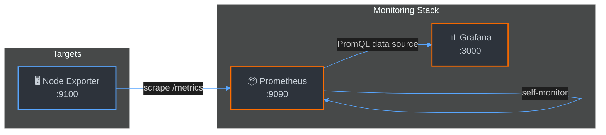

<p align="center">
  <h1 align="center">Prometheus-Grafana-Kit</h1>
  <p align="center">
    Production-ready observability stack — deploy in 30 seconds.
  </p>
</p>

<p align="center">
  <a href="https://github.com/aizik-fridman/Prometheus-Grafana-Kit/actions"></a>
  <a href="https://github.com/aizik-fridman/Prometheus-Grafana-Kit/blob/main/LICENSE"></a>
  
  
  
</p>

---

## Overview

**Prometheus-Grafana-Kit** is a batteries-included, containerized observability stack. It provisions Prometheus for metrics collection, Grafana for visualization, and Node Exporter for host-level telemetry — all wired together with a single `docker compose up`.

Designed for engineers who want a clean starting point without the boilerplate.

---

## Architecture



---

## Quick Start

### Prerequisites

| Tool             | Version  |
| ---------------- | -------- |
| Docker           | ≥ 24.0   |
| Docker Compose   | ≥ 2.20   |
| Make (optional)  | any      |

### Launch

```bash
# Clone the repository
git clone https://github.com/aizik-fridman/Prometheus-Grafana-Kit.git
cd Prometheus-Grafana-Kit

# Validate config and start the stack
make up
```

Or without Make:

```bash
docker compose up -d
```

### Access

| Service          | URL                          | Credentials      |
| ---------------- | ---------------------------- | ----------------- |
| Prometheus       | http://localhost:9090         | —                 |
| Grafana          | http://localhost:3000         | `admin` / `admin` |
| Node Exporter    | http://localhost:9100/metrics | —                 |

### Stop

```bash
make down
```

---

## Available Commands

```
make help       Show all available commands
make up         Validate config, then start the stack
make down       Stop and remove containers
make restart    Full restart (down + up)
make logs       Tail live logs from all services
make status     Show container status
make validate   Check Prometheus config via promtool
make clean      Stop stack and destroy volumes
```

---

## Repository Structure

```
Prometheus-Grafana-Kit/
├── docker-compose.yml          # Service definitions & orchestration
├── prometheus/
│   └── prometheus.yml          # Prometheus scrape configuration
├── Makefile                    # Developer workflow commands
├── .gitignore                  # VCS exclusions
├── LICENSE                     # Project license
└── README.md                   # This file
```

---

## Configuration

### Environment Variables

Override Grafana defaults by exporting variables before running `make up`:

```bash
export GF_ADMIN_USER=myuser
export GF_ADMIN_PASSWORD=secret
make up
```

### Adding Scrape Targets

Append new jobs to `prometheus/prometheus.yml`:

```yaml
scrape_configs:
  # ... existing jobs ...

  - job_name: "my-app"
    static_configs:
      - targets: ["my-app:8080"]
```

Then reload:

```bash
make restart
```

---

## License

Distributed under the [MIT License](LICENSE).
