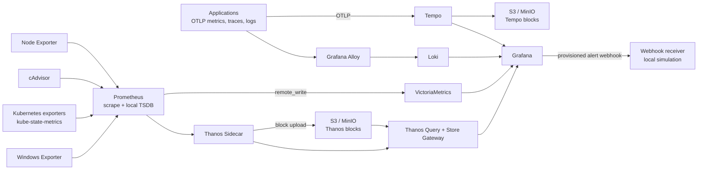

# My Monitoring stack

A reference observability platform for collecting, querying, retaining, and
alerting on application and infrastructure telemetry. Docker Compose provides
a self-contained development environment; Helm and Terraform examples show
how to move core components and object storage into AWS-backed Kubernetes.

## Project Overview

The repository brings together:

- Prometheus for scraping and short-lived local metrics, with remote write to
  VictoriaMetrics.
- Thanos Sidecar, Query, and Store Gateway for shipping Prometheus TSDB blocks
  to S3-compatible object storage and querying recent and historical data.
- VictoriaMetrics for high-throughput metrics ingestion and a separate
  30-day local metrics store.
- Grafana Tempo for OTLP traces, with MinIO locally and S3 in the AWS example.
- Grafana Alloy for Docker container log discovery and forwarding to Loki.
- Grafana with provisioned data sources, a stack dashboard, alert rules, and a
  webhook contact point.
- Node Exporter and cAdvisor for host and container metrics, plus Kubernetes
  and Windows exporter deployment guidance.

The Compose setup is intended for local evaluation and development. Its
single-node data services, development credentials, and local volumes are not
high-availability or production security configurations.

## Architecture



Prometheus is the scraper and sends samples through `remote_write` to
VictoriaMetrics. Thanos Sidecar uploads completed Prometheus TSDB blocks to
object storage; Thanos Query reads both the Sidecar store API and the Store
Gateway for recent and retained data. Tempo accepts OTLP traces and stores
blocks in MinIO locally or S3 in the cloud. Alloy tails Docker logs and ships
them to Loki. Grafana is provisioned with all four query backends.

## Repository Structure

```text
Prometheus-Grafana-Kit/
├── .github/
│   └── workflows/
│       └── ci.yml
├── config/
│   ├── alloy/
│   │   └── config.alloy
│   ├── grafana/
│   │   ├── dashboards/
│   │   │   └── stack-overview.json
│   │   └── provisioning/
│   │       ├── alerting/
│   │       │   ├── contact-points.yaml
│   │       │   ├── policies.yaml
│   │       │   └── rules.yaml
│   │       ├── dashboards/
│   │       │   └── dashboards.yaml
│   │       └── datasources/
│   │           └── datasources.yaml
│   ├── loki/
│   │   └── loki.yaml
│   ├── tempo/
│   │   └── tempo.yaml
│   └── thanos/
│       └── objstore.yml
├── kubernetes/
│   ├── README.md
│   ├── thanos-serviceaccount.yaml
│   ├── values-alloy.yaml
│   ├── values-kube-prometheus-stack.yaml
│   ├── values-loki.yaml
│   ├── values-tempo-distributed.yaml
│   └── values-victoria-metrics.yaml
├── ops/webhook-receiver/
│   ├── Dockerfile
│   └── receiver.py
├── prometheus/prometheus.yml
├── terraform/
│   ├── main.tf
│   ├── outputs.tf
│   ├── variables.tf
│   └── versions.tf
├── .env.example
├── docker-compose.yml
├── Makefile
└── README.md
```

## Prerequisites

- Docker Engine 24 or later with Docker Compose v2.
- At least 8 GB of memory available to Docker; more is recommended when
  running the complete stack.
- Make is optional. The commands below use PowerShell-compatible syntax.
- For cloud deployment: Terraform 1.6+, AWS credentials with permissions to
  create VPC, EKS, IAM, and S3 resources, plus `kubectl` and Helm 3.

## Local Deployment

Start the stack from the repository root:

```powershell
Copy-Item .env.example .env
docker compose config
docker compose up -d --build
docker compose ps
```

The `.env` file is optional; Compose defaults are for local evaluation only.
Change `GF_ADMIN_PASSWORD` before sharing the environment. The MinIO
development credentials are also referenced by the local Tempo and Thanos
configuration files; if you change `MINIO_ROOT_USER` or
`MINIO_ROOT_PASSWORD`, update those files to match. Never reuse these values
in production. The Compose configuration pins a public Bitnami legacy MinIO
image to keep the local S3-compatible simulation pullable; it is not the
upstream-maintained MinIO distribution and is not intended for production.

| Component | Local endpoint | Notes |
| --- | --- | --- |
| Grafana | http://localhost:3000 | Local default `admin` / `admin` |
| Prometheus | http://localhost:9090 | Scrape target status and local TSDB |
| Thanos Query | http://localhost:9091 | Long-term and recent PromQL |
| VictoriaMetrics | http://localhost:8428 | Metrics query UI/API |
| Tempo | http://localhost:3200 | Trace query API; OTLP gRPC :4317, HTTP :4318 |
| Loki | http://localhost:3100 | Log query API |
| MinIO console | http://localhost:9001 | Local object storage |
| Alloy | http://localhost:12345 | Collector UI |

Grafana provisions Thanos, VictoriaMetrics, Tempo, and Loki as data sources,
and imports the **Observability Stack Overview** dashboard. A sample
`PrometheusTargetDown` alert routes to the local webhook receiver. The receiver
logs payloads and returns HTTP 202; it does not execute remediation commands.
Replace it with a reviewed, authenticated integration before connecting
production alerting to automation.

Prometheus scrapes Node Exporter and cAdvisor in Compose. The repository
retains the previous synthetic-exporter target as a commented optional job.
Kubernetes and Windows exporter scrape examples are documented in the
Prometheus config; deploy those exporters in their respective environments
before enabling their targets. Docker socket access is required for Alloy's
container log discovery and grants the collector access to the Docker API.

Useful operations:

```powershell
docker compose logs -f --tail=100
docker compose restart prometheus
docker compose down
docker compose down -v  # Destructively removes all persisted local telemetry.
```

To validate the Prometheus configuration:

```powershell
docker run --rm -v "${PWD}/prometheus/prometheus.yml:/etc/prometheus/prometheus.yml:ro" `
  prom/prometheus:v3.4.2 promtool check config /etc/prometheus/prometheus.yml
```

## Production Deployment Strategy

1. Provision an AWS VPC, EKS cluster, managed node groups, cluster OIDC
   provider, and encrypted S3 buckets with Terraform in `terraform/`.
2. Configure a remote Terraform backend with locking before applying in a
   shared environment. Review the public EKS endpoint access policy, subnet
   topology, node sizing, and resource costs for the target account.
3. Apply the Kubernetes Helm values in `kubernetes/`. Install
   `kube-prometheus-stack` for Prometheus, Alertmanager, Node Exporter,
   kube-state-metrics, and Grafana; deploy VictoriaMetrics, Loki, Alloy, and
   Tempo using their respective charts.
4. Bind the Thanos and Tempo service accounts to the least-privilege IRSA
   roles output by Terraform. Create Kubernetes secrets/configuration from
   Terraform outputs using an external secret manager. Do not commit cloud
   credentials or bucket secrets.
5. Use S3 lifecycle, retention, encryption, and backup policies that match
   recovery objectives. Add ingress/TLS, authentication, network policies,
   resource quotas, storage classes, alert receiver secrets, and
   multi-AZ capacity planning before production exposure.

Terraform provisions a baseline VPC/EKS cluster, two private object-storage
buckets, and separate IRSA roles restricted to each bucket. It intentionally
does not install Helm releases, configure DNS/TLS, or create a remote Terraform
state backend. The Helm examples are starting overrides; review chart versions
and chart-specific service account annotations against the exact chart releases
you deploy.

## Design Decisions

- **Prometheus and VictoriaMetrics have different roles.** Prometheus scrapes
  targets and keeps a short local TSDB for Thanos block creation; remote write
  feeds VictoriaMetrics for high-ingest queries and retention. Thanos object
  storage is not a substitute for a current Prometheus scraper.
- **Thanos uses Sidecar plus object storage.** Completed TSDB blocks are
  uploaded to S3/MinIO. Thanos Query federates live Sidecar data with Store
  Gateway object data. This avoids maintaining a separate Thanos Receive
  write path for this reference topology.
- **MinIO isolates local object-storage dependencies.** Separate `thanos` and
  `tempo` buckets model distinct retention and access boundaries. Compose
  pins the public Bitnami legacy MinIO image because the upstream MinIO
  container registry rejects anonymous pulls; that archived image is for
  local evaluation only. Use a currently supported object-storage distribution
  or managed S3 in production. The shared local credentials are
  development-only.
- **Alloy collects Docker logs.** Its Docker discovery component tails local
  container logs; Kubernetes uses a separate Alloy configuration and
  Kubernetes API discovery. Host/container log collection depends on access to
  the Docker socket.
- **Local deployment favors clarity over availability.** Compose uses
  single-instance backends, local named volumes, and permissive development
  settings. Production values add replicas, persistent claims, S3, and IRSA,
  but still require environment-specific hardening.
- **Alert automation is intentionally non-executing.** The example webhook
  accepts and logs Grafana payloads only. Production remediation should use an
  authenticated receiver, strict alert allowlists, idempotency, audit logs,
  and human approval for disruptive actions.

## Configuration

Prometheus targets and remote write are configured in
[`prometheus/prometheus.yml`](./prometheus/prometheus.yml). Grafana
provisioning lives in [`config/grafana`](./config/grafana), while backend
configuration is under [`config`](./config). Compose environment variables
include `GF_ADMIN_USER`, `GF_ADMIN_PASSWORD`, `MINIO_ROOT_USER`, and
`MINIO_ROOT_PASSWORD`; use a local `.env` file and keep it out of version
control.
